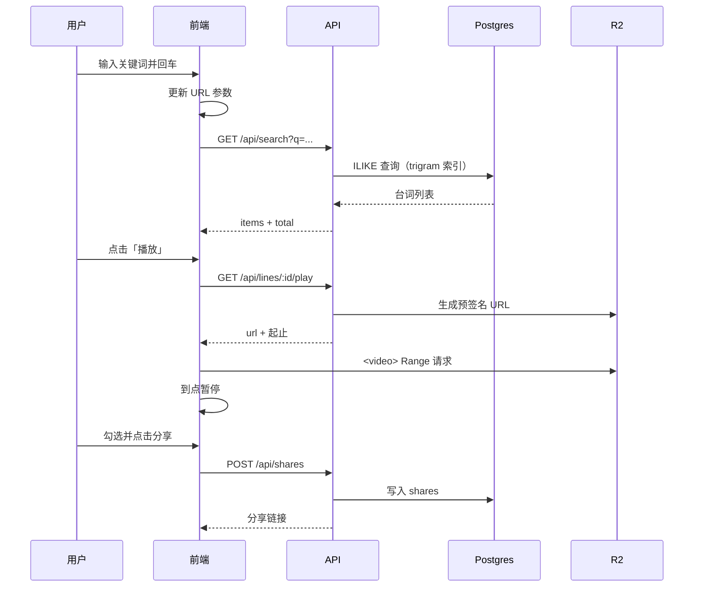

# 电视剧台词素材搜索项目实现手册

> 用途：作为后续 AI Coding（Cursor）的唯一行动依据。每个里程碑都带有「产出文件、验收标准、提示词」。
> 价格、免费额度等外部信息以各官网当日为准，文中数字是估算。
>
> 说明：本手册的技术栈（TypeScript + Postgres + R2）取代了早期草稿中的 `lib/db.js`（node:sqlite）。`lib/srt.js` 的解析与对齐逻辑思路保留，在 M1 用 TS 重写。
>
> 产品需求依据：《台词搜素材 · 产品需求与功能清单（FeatureList）》。本手册只实现其中适合「单剧、自用 MVP」的部分，取舍对照见 §12。

## 1. 目标与 MVP 边界

**一句话**：输入中文或英文关键词，返回带中英对照的台词，点击即可播放对应片段，勾选若干条后生成分享链接。

| 做（MVP） | 不做（后续） |
|---|---|
| 关键词搜索（中英混搜、多词 AND、按季筛选、分页、高亮） | 模糊语义搜索、拼写纠错 |
| 中 / 英 / 双语显示切换 | 其他语言 |
| 点击播放台词前后片段，可展开上下文；首页空态与搜索列表可展示**片段配图**（封面底图 + 季集角标 + 中英字幕），均取自视频取帧 | 视频下载、GIF、海报图（不含设计稿里「片段卡」这种体验） |
| 跨搜索勾选（最多 20 条）、生成分享链接、复制文本 | 账号体系、收藏夹、评论 |
| **不设**站点口令与登录门槛：所有页面与业务 API（含搜索、播放、discover、`/media`）**匿名即可访问**（见 §4.2）；以降低被发现概率，仍依赖 R2 私有桶 + `noindex` / `robots.txt`（不当作访问控制） | 公开运营、广告、支付 |
| 分享页只读并可播放 | 分享统计看板 |
| 精确短语开关、空结果弱相关兜底、复制文本自带出处 | 搜索联想、拼音 / 繁简容错、图文梗卡（取帧见可选的 M8） |

**数据规模预期**：以《生活大爆炸》为例，12 季、279 集，每集约 22 分钟，台词约 8 万条。

## 2. 技术选型

| 层 | 选型 | 理由 |
|---|---|---|
| 前端 | Vite + React + TypeScript + Tailwind + React Router + TanStack Query + Zustand | AI 生成设计稿还原最稳；选择状态用 Zustand，服务端状态用 Query |
| 后端 | Node 22 + Hono + TypeScript | 轻量，路由写法清晰，AI 好生成 |
| 数据库 | PostgreSQL（Neon 免费版）+ `pg_trgm` 扩展 | 托管、免运维；trigram 索引对中英文子串搜索都有效；不依赖中文分词插件 |
| 素材存储 | Cloudflare R2（S3 兼容） | 无出站流量费，约 36GB 每月不到 0.5 美元；代码只依赖 S3 接口，可换 MinIO |
| 语料管线 | Node 脚本 + ffmpeg（本机运行） | 重活（转码）在本机做，云端只存结果 |
| 部署 | Docker，一个服务同时提供 API 和静态前端 | 一个容器、一个域名，最省事 |

## 3. 代码架构

### 3.1 目录结构

```
dialogue_search/
├─ .cursor/rules/            # Cursor 项目规则（见 §10 里程碑 M0）
├─ docs/
│  ├─ IMPLEMENTATION.md      # 本手册
│  ├─ DEPLOY.md              # 部署操作文档（R2 / Neon / Render 逐步操作与上线验证命令）
│  └─ design/                # 设计稿放这里，命名见 §7.7
├─ raw/                      # 原始视频与字幕（.gitignore，永不上传 git）
│  ├─ video/S01E01.mkv
│  └─ subs/S01E01.en.srt, S01E01.zh.srt   # 或双语合一 S01E01.srt
├─ work/                     # 管线中间产物（.gitignore）：转码后的 mp4、清洗后的字幕
├─ server/
│  ├─ src/
│  │  ├─ index.ts            # 入口：创建 Hono 应用、挂中间件与路由、托管前端静态文件
│  │  ├─ config.ts           # 读取并校验环境变量（缺失就启动失败，避免线上才发现）
│  │  ├─ routes/             # 路由层：只做参数校验与返回格式，不写业务
│  │  │  ├─ search.ts        # GET /api/search
│  │  │  ├─ discover.ts      # GET /api/discover：9 条有视频的随机台词
│  │  │  ├─ lines.ts         # GET /api/lines/:id/context、/play
│  │  │  ├─ episodes.ts      # GET /api/episodes
│  │  │  ├─ media.ts         # GET/HEAD /media/*：仅本地开发（STORAGE_DRIVER=local），支持 Range
│  │  │  ├─ shares.ts        # POST /api/shares、GET /api/shares/:id、GET /api/shares/:id/lines/:lineId/play
│  │  │  └─ static.ts        # 托管前端静态文件，SPA 回退到 index.html（目录不存在则不挂载）
│  │  ├─ services/           # 业务层：组合仓储与存储，含排序、限额等规则
│  │  │  ├─ searchService.ts
│  │  │  ├─ playService.ts   # 计算片段起止、签发播放 URL
│  │  │  └─ shareService.ts  # 生成短 ID、校验数量上限
│  │  ├─ repos/              # 仓储层：只写 SQL，返回领域对象
│  │  │  ├─ linesRepo.ts
│  │  │  ├─ episodesRepo.ts
│  │  │  └─ sharesRepo.ts
│  │  ├─ storage/            # 素材存储抽象（本地开发用 local，线上用 r2）
│  │  │  ├─ types.ts         # StorageDriver 接口
│  │  │  ├─ localDriver.ts
│  │  │  └─ r2Driver.ts
│  │  ├─ middleware/
│  │  │  └─ rateLimit.ts     # M6：内存限流（单实例够用；按 IP / 路径，与「无口令」并存）
│  │  ├─ db/
│  │  │  ├─ client.ts        # Postgres 连接池
│  │  │  ├─ migrate.ts       # 迁移执行器（npm run db:migrate，M1 引入，走直连地址）
│  │  │  └─ migrations/      # 001_init.sql ...（只前进、不回滚）
│  │  └─ lib/
│  │     ├─ escapeLike.ts    # 转义 % _ \，防止用户输入被当通配符
│  │     └─ shortId.ts       # 8 位 base62 短 ID
│  └─ test/
├─ pipeline/                 # 语料管线（本机运行，不随服务部署）
│  ├─ src/
│  │  ├─ cli.ts              # 入口：ingest / transcode / upload / qa 子命令
│  │  ├─ config.ts           # 目录路径、读取 .env / .env.local、取数据库直连地址
│  │  ├─ types.ts            # Cue / DraftLine / Line 等共用类型
│  │  ├─ scan.ts             # 扫描 raw/，按 SxxEyy 归集字幕与视频，读取偏移量
│  │  ├─ ingest.ts           # 单集编排：解码 → 解析 → 清洗 → 拆分/对齐 → 校时
│  │  ├─ srt/decode.ts       # 字节转文本（BOM、UTF-8、GB18030、UTF-16）
│  │  ├─ srt/parse.ts        # SRT 解析 + 双语合一拆分
│  │  ├─ srt/clean.ts        # 去广告、去 [笑声]、去 ♪、去说话人短横线、合并断句
│  │  ├─ srt/align.ts        # 中英按时间对齐 + 平移校时 + 生成 idx
│  │  ├─ ffmpeg.ts           # 转码与字幕抽取的命令封装
│  │  ├─ loadToDb.ts         # 幂等入库（按季集 upsert）
│  │  ├─ upload.ts           # S5 上传编排（跳过已存在且大小一致的对象，失败不中断整批）
│  │  ├─ r2Store.ts          # R2 的 head / put 实现（pipeline 不引用 server，所以单独写一份）
│  │  └─ qa.ts               # 生成质量报告
│  └─ test/fixtures/         # 3～5 条自编样例，用于单测
├─ web/
│  ├─ public/robots.txt      # 全部禁止收录；构建时随静态文件一起发布
│  ├─ src/
│  │  ├─ main.tsx、App.tsx、routes.tsx
│  │  ├─ api/                # fetch 封装 + 类型（与 §6 契约一一对应）
│  │  ├─ pages/              # SearchPage / SharePage / NotFound（不单独做 GatePage）
│  │  ├─ components/         # SearchBar / FilterBar / LangToggle / DiscoverGrid / SearchResultGrid /
│  │  │                      # SnippetCard（九宫格共用）/ ClipPlayer / ContextDrawer / SearchResultOverlay /
│  │  │                      # SelectionBar / ShareDialog
│  │  ├─ hooks/              # useSearchParamsState / useClipPlayer / useVideoPosterFrame
│  │  ├─ store/selection.ts  # Zustand：已勾选台词（跨搜索保留）
│  │  ├─ store/player.ts     # Zustand：当前播放中的台词 ID（保证同时只有一个播放器）
│  │  └─ lib/                # highlight.ts、formatTime.ts、copyText.ts
│  └─ tailwind.config.ts     # 设计令牌（颜色、字号、圆角）来自设计稿
├─ Dockerfile                # 多阶段构建，见 §8.4
├─ .dockerignore             # 排除 raw/ work/ .env*，避免素材与密钥进入构建上下文
├─ docker-compose.yml        # 仅本地开发：Postgres + MinIO（可选）
└─ package.json              # npm workspaces: server / pipeline / web
```

### 3.2 分层与依赖方向

```
routes ──► services ──► repos ──► db
              │
              └──────► storage (StorageDriver)
```

- 只能自上而下依赖，禁止 `repos` 调用 `services`。
- `routes` 里不出现 SQL，`repos` 里不出现 HTTP 概念。
- `pipeline` 和 `server` 共用 `db/migrations`，但代码互不引用。

### 3.3 关键接口

```ts
// server/src/storage/types.ts
// 素材存储抽象。业务代码只依赖它，所以本地开发用文件夹、线上用 R2，
// 将来换成 MinIO / B2 只需新增一个实现。
export interface StorageDriver {
  /** 上传本地文件到存储，key 例如 "tbbt/S01E01.mp4" */
  put(key: string, localPath: string, contentType: string): Promise<void>;
  /** 判断对象是否存在，用于上传时跳过已传文件（幂等） */
  exists(key: string): Promise<boolean>;
  /** 返回浏览器可直接播放的 URL；R2 为带过期时间的预签名链接，local 为 /media/... */
  getPlayUrl(key: string, ttlSec: number): Promise<string>;
}
```

```ts
// server/src/repos/linesRepo.ts（搜索核心，示意）
// 每个关键词都必须在英文或中文里出现（AND 语义）；
// exact=1 时不拆词，整句当作一个词；AND 无结果时由 service 放宽为 OR 并标记 relaxed（见 §6）。
// 排序：整词命中优先 → 季集顺序，保证结果稳定、可翻页。
export async function search(p: { terms: string[]; season?: number; limit: number; offset: number }) {
  const params: unknown[] = [p.season ?? null];
  const conds: string[] = ['($1::int IS NULL OR e.season = $1)'];
  const rank: string[] = [];
  for (const t of p.terms) {
    params.push(`%${escapeLike(t)}%`);
    const i = params.length;
    conds.push(`(l.en ILIKE $${i} OR l.zh ILIKE $${i})`);       // 命中 trigram 索引
    params.push(`\\m${escapeRegex(t)}\\M`);
    rank.push(`(CASE WHEN l.en ~* $${params.length} THEN 1 ELSE 0 END)`); // 英文整词加权
  }
  // ... 拼出 SELECT ... ORDER BY (rank 之和) DESC, e.season, e.episode, l.idx LIMIT/OFFSET
}
```

```ts
// web/src/hooks/useClipPlayer.ts（片段播放核心，示意）
// 用整集视频 + 起止时间播放，不需要提前切片。
// 注意：<video> 的 timeupdate 约 250ms 才触发一次，会播过头，
// 因此用 requestAnimationFrame 轮询到点暂停。
async function playClip(video: HTMLVideoElement, startMs: number, endMs: number) {
  video.currentTime = Math.max(0, (startMs - 400) / 1000);   // 前留 0.4s
  await video.play();
  const stopAt = (endMs + 300) / 1000;                         // 后留 0.3s
  const tick = () => {
    if (video.currentTime >= stopAt) video.pause();
    else if (!video.paused) requestAnimationFrame(tick);
  };
  requestAnimationFrame(tick);
}
```

## 4. 语料库建设方案

### 4.1 数据从哪来（重要）

不提供盗版视频站的下载地址，也不建议使用。原因有两个：一是会带来下架和法律风险，二是这类文件的字幕与画面常对不上，会直接拖垮开发。可用的合法路径如下。

| 数据 | 推荐来源 | 说明 |
|---|---|---|
| **MP4 视频** | ① 自己购买的光盘（DVD / 蓝光），自用翻录<br>② 自己已合法持有的文件 | 光盘最稳：画面和官方字幕天然对应。翻录是否合法取决于所在地区，请自行确认。流媒体平台（Netflix、HBO Max 等）的内容有 DRM，不要做录屏或破解 |
| **英文字幕** | ① 从自己的光盘或文件里抽取内封字幕<br>② OpenSubtitles | 文本字幕可用 `ffmpeg -i in.mkv -map 0:s:0 out.srt` 抽取；图片字幕（DVD 的 VobSub、蓝光的 PGS）需要 OCR，可用 Subtitle Edit 或 pgsrip |
| **中文字幕** | ① 国内版光盘的简繁字幕<br>② 字幕站，如射手网（assrt.net）、OpenSubtitles | 字幕站内容多为社区上传，授权不明，仅限个人学习使用。**务必挑与你视频版本匹配的**（如 “BluRay”“WEB-DL” 要和视频一致） |
| **只想先验证产品** | 第一季 17 集 | 体量小、易校验、存储免费 |

### 4.2 版权与访问控制（硬性要求）

1. **不入 git。** `raw/`、`work/` 写进 `.gitignore`，字幕和视频都不能进仓库。
2. **私有存储桶。** R2 桶不开公开访问，只通过 API 签发短期预签名链接。
3. **不设登录/口令门槛（单人自用、知道站点 URL 即可用）。** **不实现** `POST /api/auth`、`SITE_PASSCODE`、`COOKIE_SECRET`、`GatePage` / `gate` 门禁：**所有**业务 API（搜索、上下文、播放、discover、分享写入等）以及本地开发时的 `/media/*` **均不要求** cookie 或前置认证。实际防护依赖：① **R2 桶私有**，成片只能通过预签名 URL 访问；② 站点仅自分发的域名可达、URL 不公开扩散；③ 全站 `<meta name="robots" content="noindex">` + `robots.txt` 全部 `Disallow`，**降低被搜索引擎收录的概率**（不是访问控制，防不住直接访问）。生产环境用 **M6 / M7 的按 IP 限流**缓解扫接口与滥用（见 `middleware/rateLimit.ts`）。
4. **只做个人、小圈子自用。** 一旦要公开运营，必须先解决授权，这是产品决策，不是技术问题。
5. **出处与下架通道。** 复制和分享的文本默认附带出处（片名、季集、时间点），且不可关闭；页脚和分享页放「权利声明 / 投诉」联系方式（一个邮箱即可），收到通知后 48 小时内处理。（对应 FeatureList F4.6、F8.3）

### 4.3 处理流水线

```
raw/video  ──S1 转码──► work/mp4/S01E01.mp4 ──S5 上传──► R2: tbbt/S01E01.mp4
raw/subs   ──S2 清洗/校时──► S3 中英对齐 ──S4 入库──► Postgres (lines/episodes)
                                          └──S6 QA 报告──► work/qa-report.md
```

| 步骤 | 命令（`pipeline` 子命令） | 做什么 |
|---|---|---|
| S1 转码 | `npm run pipeline -- transcode` | 统一转成 480p H.264 mp4，**每秒一个关键帧并把索引放文件头**，这样浏览器才能精准跳到任意台词并边下边播 |
| S2 清洗与校时 | `... ingest --clean` | 去广告和字幕组水印、去 `[laughs]`、去 `♪`、合并断句；如果字幕与视频整体错位，用 `ffsubsync` 或手填偏移量，并在入库时直接平移时间戳，让库里的时间永远等于视频时间 |
| S3 对齐 | 同上 | 中英文按时间重叠对齐（`align.ts`） |
| S4 入库 | 同上 | 以「季 + 集」做 upsert，可重复运行，不产生重复数据 |
| S5 上传 | `... upload` | 已存在的对象跳过，可断点续传 |
| S6 QA | `... qa` | 输出每集：台词数、中英都有的比例、时间戳是否递增、与视频时长的偏差 |

转码命令（写进 `ffmpeg.ts`）：

```bash
# 选英文音轨；缩放到 480p；约 1 秒一个关键帧（24fps 时 -g 24）；索引前置；去掉内封字幕
# 注意：音轨选择器末尾不能加 ?（ffmpeg 9 会把它当成语言值的一部分而报错）。
# 管线会先用 ffprobe 探测：有 eng 标签用 0:a:m:language:eng，没有就退回 0:a:0?，避免片源没打标签时静音。
ffmpeg -i raw/video/S01E01.mkv \
  -map 0:v:0 -map 0:a:m:language:eng \
  -vf "scale=-2:480" -c:v libx264 -crf 26 -preset slow \
  -g 24 -keyint_min 24 -sc_threshold 0 \
  -c:a aac -b:a 96k -ac 2 -sn \
  -movflags +faststart work/mp4/S01E01.mp4
```

### 4.4 质量验收线

- 中英都有的台词占比 ≥ 90%，低于此值的集在 QA 报告里标红，人工抽查。
- 每集随机抽 5 条：点击播放，台词与画面口型误差 ≤ 1 秒。
- 时间戳单调递增，没有负时长或超出视频时长的条目。
- 单条台词时长建议 ≤ 15 秒（FeatureList 的「超短引用」约束，也避免播放片段过长）；超过的在 QA 报告里列出，人工确认是否为字幕合并错误。

### 4.5 存储方案与成本（要不要 MinIO）

**结论：关系数据放 Postgres，视频放对象存储，线上用 Cloudflare R2，不用 MinIO。**

| 方案 | 月成本（全 12 季） | 运维 | 结论 |
|---|---|---|---|
| **R2（推荐）** | 约 0.4 美元（36GB 减去 10GB 免费额度，再乘以 0.015 美元/GB），出站流量免费 | 几乎没有 | ✅ 最省钱省心 |
| Supabase Storage | 免费版仅 1GB 存储，且单文件上限约 50MB，而一集 480p 约 130MB，**直接放不进去**；要放视频得升级付费版（约 25 美元/月起） | 低 | ❌ 视频不适合；存小文件（封面图等）可以 |
| Backblaze B2 | 约 0.2 美元，出站有额度限制 | 低 | 备选 |
| 自建 MinIO | 需要一台带磁盘的服务器，至少 5 美元/月，还要自己管备份和升级 | **高** | ❌ 单人项目不划算。MinIO 社区版近期的维护和功能策略有调整，选型前请自行核实 |
| 视频放 VPS 本地磁盘 | 40GB 磁盘的 VPS 约 5 美元/月 | 中 | 可行，但磁盘一满就卡死，不推荐 |

体量估算：480p 约 130MB/集 × 279 集 ≈ 36GB。第一季约 2.2GB，在 R2 的 10GB 免费额度内。

**关于 Supabase：**

- Supabase 的 **Storage** 不适合存视频，原因见上表（免费版容量和单文件限制，数字以官网为准）。
- Supabase 的 **Postgres** 可以替代 Neon，同样支持 `pg_trgm`，好处是账号少一个；缺点是免费项目连续约一周无访问会被暂停，需要手动恢复。个人使用频率不高时，Neon 的「闲置自动休眠、访问自动唤醒」更省心。
- 推荐组合：**R2 存视频 + Neon（或 Supabase）存数据**。代码里数据库只依赖 `DATABASE_URL`，存储只依赖 `StorageDriver`，两者随时可以互换，不会被某家绑死。

**不要预先切片。** 8 万条台词各切一个小视频，既占存储又难维护。只存整集视频，靠 Range 请求播放。只有以后做「下载片段」时，才按需调用 ffmpeg 生成并缓存。

本地开发默认用 `localDriver`（读 `work/mp4`），不需要 MinIO，也不需要联网。

## 5. 数据库设计（`001_init.sql`）

```sql
CREATE EXTENSION IF NOT EXISTS pg_trgm;

CREATE TABLE episodes (
  id          SERIAL PRIMARY KEY,
  season      INT  NOT NULL,
  episode     INT  NOT NULL,
  title_en    TEXT,
  title_zh    TEXT,
  video_key   TEXT,                 -- 存储里的对象键，如 tbbt/S01E01.mp4；为空表示只有文字
  duration_ms INT,
  offset_ms   INT NOT NULL DEFAULT 0, -- 入库时已平移的偏移量，仅作记录
  UNIQUE (season, episode)
);

CREATE TABLE lines (
  id         BIGSERIAL PRIMARY KEY,
  episode_id INT NOT NULL REFERENCES episodes(id) ON DELETE CASCADE,
  idx        INT NOT NULL,          -- 集内序号，用于取上下文
  start_ms   INT NOT NULL,
  end_ms     INT NOT NULL,
  en         TEXT NOT NULL DEFAULT '',
  zh         TEXT NOT NULL DEFAULT '',
  UNIQUE (episode_id, idx),
  CHECK (end_ms > start_ms)
);
-- 子串搜索索引：同时支持英文和中文，无需中文分词
CREATE INDEX lines_en_trgm ON lines USING gin (en gin_trgm_ops);
CREATE INDEX lines_zh_trgm ON lines USING gin (zh gin_trgm_ops);

CREATE TABLE shares (
  id         TEXT PRIMARY KEY,      -- 8 位 base62 短 ID
  line_ids   BIGINT[] NOT NULL,     -- 保持用户勾选顺序
  note       TEXT,                  -- 分享留言，可空，≤100 字
  created_at TIMESTAMPTZ NOT NULL DEFAULT now(),
  view_count INT NOT NULL DEFAULT 0
);
```

- 单字符中文（如「钱」）搜索时 trigram 索引帮不上忙，会退化成全表扫描。8 万行约几十毫秒，可以接受。
- 搜索入口强制要求关键词至少 1 个字符，且长度上限 50 个字符。

## 6. API 契约

所有接口返回 JSON，错误统一为 `{ "error": { "code": "...", "message": "..." } }`。**不设**站点口令：`/healthz` 之外的**全部**业务 API 均匿名可调用（依赖 §4.2 的其它约束 + M6/M7 限流防滥用）。

| 接口 | 说明 | 要点 |
|---|---|---|
| `GET /api/search` | `q`（必填）、`season`、`exact`（`1` 表示仅完整台词）、`page`（默认 1）、`pageSize`（默认 20，最大 50） | 见下方返回结构 |
| `GET /api/lines/:id` | 无额外参数 | 返回单条台词，**JSON 与 `GET /api/search` 的 `items[]` 单项同形**；供深链 `?lineId=` 在首页拉取；不存在返回 404 `NOT_FOUND` |
| `GET /api/lines/:id/context` | `before`、`after`（各默认 2，最大 5） | 返回同集前后台词，含本条 |
| `GET /api/lines/:id/play` | 返回播放用 URL 与起止 | 有视频才返回；URL 有效期 1 小时 |
| `GET /api/episodes` | 季集列表（筛选器用） | 可缓存 |
| `GET /api/discover` | 无查询参数 | 返回 **9** 条随机推荐台词（结构同 `search` 的 `items[]` 单项），仅供首页空态「Discover」区使用；每次请求重新抽样 |
| `POST /api/shares` | 请求 `{lineIds: number[], note?: string}` | 1～20 条；返回 201 `{id, url}`；需通过限流（M6/M7） |
| `GET /api/shares/:id` | 凭链接访问 | 返回留言与台词列表（不含播放 URL）；每次成功读取 `view_count + 1`；限流（M7） |
| `GET /api/shares/:id/lines/:lineId/play` | 分享上下文内播放 | 仅当 `lineId` 属于该分享才签发播放 URL，返回结构与 `/api/lines/:id/play` 相同；不计浏览量；限流（M7） |

```jsonc
// POST /api/shares  请求
{ "lineIds": [12345, 12399], "note": "这两句放一起很搭" }
// 201 响应：url 由 PUBLIC_BASE_URL 拼成
{ "id": "aB3dE9xZ", "url": "https://example.com/s/aB3dE9xZ" }

// GET /api/shares/aB3dE9xZ
{
  "id": "aB3dE9xZ",
  "note": "这两句放一起很搭",          // 无留言时为 null
  "createdAt": "2026-11-06T10:00:00.000Z",
  "items": [{                          // 顺序即用户勾选顺序
    "id": 12345,
    "episode": { "season": 2, "episode": 5, "titleEn": "...", "titleZh": "..." },
    "startMs": 123400, "endMs": 125900,
    "en": "...", "zh": "...",
    "hasVideo": true
  }]
}
```

- `lineIds`：数组，每项为正的安全整数，1～20 条；重复项去重并保留首次出现的位置；任一 id 不存在返回 400 `BAD_REQUEST`。`note` 去首尾空白后最长 100 个字符，空串按无留言处理。请求体不是合法 JSON 或字段类型不对，返回 400。
- 分享里的台词若在语料重灌后已不存在，读取时直接略过；全部不存在返回 404 `NOT_FOUND`。
- 为什么不在 `GET /api/shares/:id` 里直接带播放 URL：分享链接只应能签发所选台词的播放地址，且点播放时才签发，避免每次打开页面都为每集查询存储。

```jsonc
// GET /api/search?q=bazinga&season=2
{
  "total": 37, "page": 1, "pageSize": 20,
  "relaxed": false,   // true 表示没有同时含全部关键词的台词，items 是「含部分关键词」的弱相关结果
  "items": [{
    "id": 12345,
    "episode": { "season": 2, "episode": 5, "titleEn": "...", "titleZh": "..." },
    "startMs": 123400, "endMs": 125900,
    "en": "Bazinga!", "zh": "巴辛嘎！",
    "hasVideo": true
  }]
}
```

```jsonc
// GET /api/lines/12345
// 响应与上表 search items[] 单项同形
{
  "id": 12345,
  "episode": { "season": 2, "episode": 5, "titleEn": "...", "titleZh": "..." },
  "startMs": 123400, "endMs": 125900,
  "en": "Bazinga!", "zh": "巴辛嘎！",
  "hasVideo": true
}
```

```jsonc
// GET /api/lines/12345/context?before=2&after=2
// lines 按集内序号升序，包含本条；遇到集首 / 集尾时条数会少于 before + after + 1，不会跨集
{
  "episode": { "season": 2, "episode": 5, "titleEn": "...", "titleZh": "..." },
  "currentId": 12345,
  "lines": [
    { "id": 12343, "idx": 41, "startMs": 118000, "endMs": 120200, "en": "...", "zh": "..." },
    { "id": 12345, "idx": 43, "startMs": 123400, "endMs": 125900, "en": "Bazinga!", "zh": "巴辛嘎！" }
  ]
}
```

```jsonc
// GET /api/episodes
{
  "items": [
    { "season": 1, "episode": 1, "titleEn": "...", "titleZh": "...", "hasVideo": true }
  ]
}
```

- **无「站点级」401**：业务错误仍用 4xx（如参数不对 `400`、资源不存在 `404`）；**不出现**因「未登录」导致的 `401 UNAUTHORIZED`。
- 参数不合法（`q` 为空或超过 50 字符、`season` / `page` / `pageSize` / `before` / `after` 越界或非整数）返回 400 `BAD_REQUEST`；台词不存在返回 404 `NOT_FOUND`。
- `q` 按空白切成多个词（AND 语义），去重后最多取前 5 个词。
- `exact=1`：不拆词，把整个 `q`（去掉首尾空白）当作一个连续片段匹配，解决「词太多、结果爆炸、无法收紧」的问题。`exact` 参数非 `1` 或缺省都按默认处理。
- 空结果兜底：默认模式下，多词 AND 没有结果时，自动放宽为 OR（含任一词即可，命中词越多越靠前），返回 `relaxed: true`；仍然没有结果才返回空列表。`exact=1` 时不放宽。

```jsonc
// GET /api/lines/12345/play
{ "url": "https://...r2.cloudflarestorage.com/...signed", "startMs": 123400, "endMs": 125900, "expiresAt": 1730868000 }
```

- `startMs` / `endMs` 是台词本身的起止，不含缓冲；前后各留 0.4s / 0.3s 由前端播放器处理。`expiresAt` 为秒级时间戳。
- 台词不存在返回 404 `NOT_FOUND`；该集没有视频（`video_key` 为空，或存储里找不到对象）返回 404 `NO_VIDEO`。
- 本地开发（`STORAGE_DRIVER=local`）时 `url` 形如 `/media/tbbt/S01E01.mp4`，由 `routes/media.ts` 提供：支持 `GET` / `HEAD` 与 `Range`（206、`Content-Range`、`Accept-Ranges: bytes`），`Range` 越界返回 416。线上用 R2 预签名链接，不经过该路由。

## 7. 前端设计

### 7.1 页面与路由

| 路由 | 页面 | 说明 |
|---|---|---|
| `/` | 搜索页（主页面） | **默认落地页**（§4.2）；搜索、结果、勾选、分享入口；业务 API 无口令，不出现「整页登录」 |
| `/s/:id` | 分享页 | 只读 |
| `*` | 404 | 含「分享已失效」文案 |

### 7.2 搜索页结构

**空态（无关键词）是 hero 首页**：顶栏只有 logo、语言切换、主题切换；中央依次是胶囊标签、大标题、副标题、大号搜索框（主按钮嵌在右侧）、带语种标注的示例词胶囊、三项能力简介。**其下为「随机推荐」区**（设计稿 `06-discovery-grid`）：共 **9** 张片段卡，排成响应式网格（桌面端多为 3×3）。每张卡以该台词对应时刻的**视频画面**为底图（见 §7.9）：用 `<video>` 设 `currentTime` 到中点并暂停，**不用** canvas 截图（R2 预签名为跨域资源时 canvas 会被污染，导出的 data URL 为空）；**左上角**叠放角标，标明所属 **季** 与 **集**（文案格式如 `S02 · E05`）；**卡片下半部**叠放该行台词的**英文一行 + 中文一行**（九宫格卡与**片段蒙版**均固定双语叠在画面上；顶栏「英 / 中 / 双语」主要作用于**关键词高亮**、分享页等处）。数据来自 `GET /api/discover`；进入页面时拉取一次即可，不要求无限滚动。

有关键词后变为下面的结果页，搜索框收进吸顶顶栏；**本实现**采用与推荐区**同构的九宫格**（`SearchResultGrid` + `SnippetCard`，每页最多 `pageSize` 张，默认 20，仍为响应式 3×2 / 3×3 等）；卡片底部条保留 **勾选、查看片段、播放、上下文**（与旧版列表卡能力对齐）。

```
┌────────────────────────────────────────────┐
│ [ 搜索框 ········· ] [搜索]      [英|中|双语] │  ← 顶栏
│ 季：[全部 ▾]            共 37 条结果          │  ← 筛选与统计
├────────────────────────────────────────────┤
│  ┌────┐ ┌────┐ ┌────┐   ← 九宫格片段卡（同 06）    │
│  │视频│ │视频│ │视频│   底：英+中；条：勾选/查看/播/上下文 │
│  └────┘ └────┘ └────┘                            │
├────────────────────────────────────────────┤
│  上一页  1 2 3 …  下一页                     │
└────────────────────────────────────────────┘
        已选 3 条 [预览/分享] [清空]   ← 底部悬浮条，有勾选才出现
```

**带关键词时的结果页（九宫格 + 片段蒙版，设计稿 `07-search-result-overlay`）**：用户点击卡片**上方画面区**或 **「查看片段」** 后，在当前页上方打开蒙版（与推荐区一致）。蒙版内以**大尺寸 16:9 视频静帧**（同 §7.9）+ **左上当季集角标** + **画面底部渐变条上叠英文、中文两行**（不在视频下方单独开一块白/黑字幕区）；再往下是 **「上一条」「下一条」**、**「复制链接」**；导航范围仍为**当前页的 `items`**，含分页语义（末条「下一条」翻到下一页首条等，与此前实现一致）。深链 `?lineId=` 行为不变。

### 7.3 交互细节

| 场景 | 行为 |
|---|---|
| 提交搜索 | 回车或点按钮；URL 同步为 `/?q=...&season=...&exact=1&page=...`，可刷新、可分享、可回退 |
| 空搜索 | 不请求列表接口；显示热门示例词（如 Bazinga、Penny、Sheldon），点击即搜；同时请求 `GET /api/discover` 填满 9 张推荐卡（失败时该区域显示占位或隐藏，不出现整页白屏） |
| 推荐卡点击 | 与搜索结果的片段蒙版一致：打开蒙版，默认定位到该条，可在蒙版内用「上一条 / 下一条」浏览（此时「下一条」在 9 条推荐集合内循环或到达末尾禁用，实现时二选一并在 PR 说明） |
| 搜索结果 → 片段蒙版 | 点击九宫格卡片**画面区**或「查看片段」打开蒙版（见 §7.2 `07`）；**上一条 / 下一条**仅在当前页结果序列中移动；**复制链接**复制当前条的 `?lineId=` 深链 |
| 无结果 | 提示「没有找到」，附带建议：少写几个词、换成中文或英文；永不出现空白页（乱码输入也要在 600ms 内给出提示或兜底结果） |
| 弱相关兜底 | 接口返回 `relaxed: true` 时，列表顶部显示一条提示：「没有同时包含全部关键词的台词，下面是包含部分词的结果」 |
| 仅完整台词 | 搜索栏旁一个开关，开启后加 `exact=1`；结果是默认结果的子集。结果数超过 2000 条时，在结果顶部提示「结果较多，试试仅完整台词」 |
| 结果数文案 | ≤ 5000 显示「N 条结果」；5000～30000 显示「5,000+ 条」；超过 30000 显示「海量结果」（阈值可调） |
| 高亮 | 关键词在英文和中文里都高亮；高亮前先做 HTML 转义，防注入 |
| 语言切换 | 三态（英 / 中 / 双语），存入 `localStorage`，默认双语；**九宫格与片段蒙版画面上的字幕**固定英+中两行（§7.2）；语言切换主要影响**关键词高亮**、分享页等 |
| 播放 | 点击「播放」在卡片内展开播放器，自动播放；**同一时刻只允许一个播放器**，开新的会关闭旧的；播放到结束时间自动暂停，按钮变成「重播」 |
| 上下文 | 展开显示前后各 2 句，当前句高亮，点任意一句可以从那里播放 |
| 勾选 | 点击卡片左上角的复选框；**勾选跨搜索、跨分页保留**（存 Zustand，并同步到 `sessionStorage`）；超过 20 条时弹提示并阻止 |
| 分享 | 点底部「分享」打开对话框：列出已选台词（可移除单条）、可填留言 → 点「生成链接」→ 显示链接，提供「复制链接」和「复制文本（中英对照，附出处）」两个按钮 |
| 复制文本格式 | 每条三行：英文、中文、`—— 《片名》S02E05 12:03`（片名取自前端常量 `SERIES_TITLE`，目前只有一部剧，不改表）。**出处行不可关闭** |
| 分享页 | 展示留言与台词列表，每条可播放；底部有「去搜索更多」 |
| 加载与错误 | 搜索中显示骨架屏；接口失败显示可重试的错误条；播放链接过期（403）时自动重新请求一次 |
| 移动端 | 单列；分享对话框改为底部抽屉；播放器宽度撑满；`DiscoverGrid` 为 2 列或 1 列；片段蒙版占满视口，按钮区避免被安全区遮挡 |

| 结果列表形态 | **有关键词时**：采用与 `06` 同构的九宫格（`SearchResultGrid`）；**配图**统一走 §7.9。若某条无视频或静帧失败，卡片降级为纯色底 + 季集角标 + 双语字幕 |

### 7.4 数据流



### 7.5 状态划分

| 状态 | 位置 | 说明 |
|---|---|---|
| 关键词、季、exact、页码 | **URL**（唯一事实来源） | 用 `useSearchParams` 读写 |
| 可选：`lineId` | **URL** | 深链打开片段蒙版时用；与 `q` 可同时存在（从分享链回到搜索上下文） |
| 搜索结果、上下文、分享详情、推荐列表 | TanStack Query | 自动缓存、重试；`discover` 单独 query key |
| 片段蒙版：当前索引、是否打开 | Zustand 或 URL + 派生 | 蒙版内「上一条 / 下一条」依赖当前列表（搜索结果页 items 或 discover 的 9 条） |
| 已勾选台词 | Zustand + `sessionStorage` | 存完整台词对象，分享对话框无需再请求 |
| 语言模式 | Zustand + `localStorage` | |
| 当前播放中的台词 ID | Zustand | 保证同时只有一个播放器 |

### 7.6 组件职责

| 组件 | 输入 | 职责 |
|---|---|---|
| `SearchBar` | `value`、`onSubmit` | 输入与提交，不请求数据 |
| `FilterBar` | `season`、`exact`、`total` | 季筛选、「仅完整台词」开关、结果数文案 |
| `LangToggle` | — | 读写语言模式 |
| `DiscoverGrid` | `lines[]`（来自 discover） | 渲染随机推荐 9 宫格；内部用 `SnippetCard`（`variant=discover`） |
| `SearchResultGrid` | `items[]`（来自 search） | 渲染有搜索词时的九宫格；内部用 `SnippetCard`（`variant=search`，含勾选 / 播放 / 上下文） |
| `SnippetCard` | `line`、`terms`、`variant` | 片段卡共用：静帧底图 + 角标 + 固定双语字幕；点击画面上方打开 `SearchResultOverlay` |
| `ClipPlayer` | `lineId` | 请求播放信息、渲染 `<video>`、到点暂停 |
| `ContextDrawer` | `lineId` | 展示前后台词 |
| `SearchResultOverlay` | `lines[]`、`initialIndex`、`onClose` | 蒙版内导航、复制单条深链；16:9 区内 `<video>` 展示 §7.9 静帧，**画面底部叠双语字幕**（固定 `both`，与顶栏语言无关） |
| `SelectionBar` | — | 悬浮条，显示数量与入口 |
| `ShareDialog` | — | 预览已选、生成链接、复制 |

### 7.7 设计稿接入方式

把设计稿按下面命名放进 `docs/design/`，之后在 Cursor 里用 `@` 引用，AI 就能对照实现。

| 文件名 | 内容 |
|---|---|
| `01-search-desktop.png` | 搜索页桌面端（含空态） |
| `02-search-mobile.png` | 搜索页移动端 |
| `03-result-card.png` | 结果卡片（普通、勾选、播放展开三种状态） |
| `04-share-dialog.png` | 分享对话框 |
| `05-share-page.png` | 分享页 |
| `06-discovery-grid.png` | 空态首页：随机推荐 **9** 个片段；截图底图 + 左上角季集角标 + 底部中英字幕 |
| `07-search-result-overlay.png` | 搜索有结果时：点击片段后以蒙版展示，支持上一条 / 下一条切换、复制链接 |

> 仓库里若仍使用 `06.png`、`07.png` 等短文件名，在提示词里 `@docs/design/06.png` 即可；上表为推荐命名，便于区分后续补充稿（若日后增加 `08-xxx.png` 等）。

拿到稿子后，先让 AI 提取「设计令牌」写进 `tailwind.config.ts`：主色、背景色、文字色、字号层级、圆角、间距。初始令牌值见 §7.8，与设计稿不一致的以设计稿为准。然后再做组件，不要边做组件边猜颜色。如果设计稿与本节的交互冲突，**以设计稿为准**，并更新本节。

### 7.8 设计令牌与视觉规则（青色清新方向）

> **变更说明**：`docs/design/` 的参考图（01 为 33台词，02～05 为 Yarn）都是高饱和、偏年轻的风格，与 FeatureList §B 的「莫兰迪 + 陶土橙」冲突。按 §7.7「以设计稿为准」，视觉方向改为**青色清新**；FeatureList §B 不再作为视觉依据。`06` / `07` 的**片段配图 + 蒙版导航**纳入 MVP（见 §7.9）；`02`～`05` 若与当前令牌冲突，以各图为准迭代 §7.8。

风格：近白偏冷的底色 + 细网格与顶部光晕，一个青色品牌色，圆润胶囊，两级柔和阴影。令牌写在 `tailwind.config.ts`，取值以 CSS 变量形式放在 `index.css`，亮 / 暗两套同名，组件里只引用语义名，不写死颜色。

| 类别 | 令牌 | 亮色 / 暗色 | 用途 |
|---|---|---|---|
| 颜色 | `surface-page` | `#F5F9FB` / `#0B1418` | 页面底色 |
| | `surface` | `#FFFFFF` / `#111D23` | 卡片、输入框、浮层 |
| | `surface-muted` | `#EBF2F6` / `#182830` | 骨架、悬停底、分段控件底 |
| | `ink` / `ink-sub` / `ink-faint` | `#0F1B24 #475B69 #627689` / `#E6F1F5 #9DB4C0 #7F97A4` | 主文本 / 次级 / 弱提示（含占位符）。文字对比度均 ≥ 4.5:1 |
| | `line` | `#DAE7ED` / `#23363F` | 描边与分隔线 |
| | `brand` | `#0E7C8F` / `#0E8196` | **按钮等实心底色**，白字对比度 ≥ 4.5:1；`brand-hover` 再深一档 |
| | `brand-fg` | `#0E7C8F` / `#4FD1E0` | 品牌色**文字、图标、描边**（暗色下需提亮） |
| | `brand-soft` | `#E1F4F7` / `#123740` | 选中态、标签、当前句底色 |
| | `glow` | `#22C3D6` | 仅用于光晕、网格渐隐、高亮下划线，不用于文字 |
| | `danger` / `danger-soft` | `#B4372E #FDEEEC` / `#F28B82 #3A1B1A` | 错误提示 |
| 圆角 | `card / control / pill` | 16px / 12px / 999px | 卡片与弹层 / 按钮与输入框 / 胶囊 |
| 阴影 | `shadow-soft` | `0 1px 2px rgba(15,27,36,.04), 0 6px 16px rgba(15,27,36,.06)` | 卡片默认态 |
| | `shadow-lift` | `0 12px 28px rgba(15,27,36,.12)` | hover / 聚焦，配合上浮 2px |
| | `shadow-glow` | `0 8px 28px -6px` + `glow` 色 | 仅搜索框与主按钮 |
| 动效 | 时长 | 点按 120ms、状态切换 180ms、入场 240ms，一律 `ease-out` | |
| | 反馈 | 按压 `scale(.98)`；卡片 hover 上浮 2px；播放键点击一次轻脉冲 | |
| | 禁用 | 循环装饰动画（骨架流光除外）、视差、超过 300ms 的入场；`prefers-reduced-motion` 下全部关闭 | |
| 字体 | 中文 | 系统字体（苹方 / 微软雅黑 / 思源黑体）；字重只用 400 / 600 / 800；时间、计数用 `tabular-nums` | |
| 暗色模式 | 切换 | 首次跟随系统；顶栏开关手动切换并存 `localStorage`；`index.html` 内联脚本在首屏前设置 `dark` 类，避免闪白 | |

使用规则：

- 品牌色只承担「主操作 + 当前状态」：搜索按钮、播放键、选中态、命中词高亮；其余层级用描边与灰度区分。
- `glow` 不能做文字色（对比度不够）；品牌色文字一律用 `brand-fg`。
- 命中词高亮为「荧光笔」式半透明下划线底，文字颜色不变，亮暗模式通用。
- 片段卡片的**暗角与字幕条**需保证 WCAG 对比度（字幕描边或半透明底条二选一），具体数值以对 `06` / `07` 还原为准。

### 7.9 片段画面（Discover / 九宫格结果 / 蒙版共用）

设计稿 `06`、`07` 的底图来自**台词对应时刻的视频画面**，不是单独海报素材。

- **时刻**：在台词起止的中点定格：\((startMs + endMs) / 2\) 秒，与管线里的时间轴一致。
- **实现（MVP）**：对每条卡片请求 `GET /api/lines/:id/play` 拿到预签名 URL，在**可见或叠放的** `<video>` 上设置 `currentTime` 后 `pause()`，用视频帧本身作为「关键帧」展示。**不得**依赖 `canvas.drawImage` + `toDataURL` 作为卡片底图：R2 预签名 URL 为跨域资源时，画布会被污染，截图为空。
- **不要**给用于静帧的 `<video>` 设置 `crossOrigin="anonymous"`（或 `crossorigin`，等价）：在 CORS 模式下，若 R2 桶**未**对预签名 GET 返回 `Access-Control-Allow-Origin`（默认往往如此），整段视频加载会 **失败**（`error`），表现为永远只有渐变、无画面。**静帧只显示像素、不读 canvas，不需要 CORS**；播放用的 `<video>`（`ClipPlayer`）同样不显式设 crossOrigin。
- **预生成缩略图入库（可选，非 MVP）**：可把管线截好的 JPEG 存 R2、库里只存 key/url，列表用 ``。好处是首屏不重；代价是迁移、存储与管线插帧。**当前不做**：仍以 `<video>` seek 为准。
- **性能**：TanStack Query 按 `lineId` 缓存 `play` 响应；首屏最多 9～20 路 `<video>` 元数据 + seek，弱网可能略慢，以加载圈为反馈。
- **失败**：无视频、请求失败、`error` 事件时降级为纯色渐变底，仍显示角标与双语字幕。

> **与 M8 的区别**：M8「导出截图」若仍用 canvas，必须在 R2 桶上配置 **CORS**（允许站点 origin 对视频对象 `GET`），并给用于导出的 `<video>` 设 `crossOrigin="anonymous"`，否则画布被污染；**MVP 静帧路径不依赖**该配置。

## 8. 部署方案

### 8.1 方案对比

| | A：零成本验证（先用这个） | B：稳定长期（A 跑顺后再切） | C：自己的电脑 |
|---|---|---|---|
| 前后端 | Render 免费 Web Service（Docker） | 海外 VPS（约 4～6 美元/月）+ Docker Compose + Caddy | 本机运行，用 Cloudflare Tunnel 对外 |
| 数据库 | Neon 免费 | 同左，或 VPS 内自建 Postgres | 本机 Postgres |
| 视频 | R2 | R2 | 本地文件夹 |
| 月成本 | **约 0～0.5 美元** | 约 5～6 美元 | 0（要一直开机） |
| 缺点 | 15 分钟无访问会休眠，首次打开要等数十秒 | 要管服务器 | 关机即不可用 |

> 国内访问提示：A、B 方案都部署在海外，大陆访问速度可能不稳定，视频首帧可能偏慢。如果用户主要在大陆，建议先小范围实测。改用国内云服务要考虑备案，同时也会增加版权审核风险。

### 8.2 方案 A 实施步骤

**准备（一次性，约 1 小时）**

1. 本机安装工具：`brew install ffmpeg node@22`。
2. 注册 Cloudflare，创建 R2 桶 `tbbt-media`（保持私有）；生成 API 令牌，权限为「对象读写」，记下 `Account ID`、`Access Key ID`、`Secret`。
3. 注册 Neon，创建项目，复制连接串到 `DATABASE_URL`，在 SQL 控制台启用 `pg_trgm`（或直接运行迁移）。
4. 把代码推到 GitHub 私有仓库（确认 `raw/`、`work/` 没被提交）。

**灌入语料（在本机执行）**

```bash
cp .env.example .env            # 填入 DATABASE_URL 与 R2_* 变量
npm run db:migrate              # 建表
npm run pipeline -- transcode   # S1
npm run pipeline -- ingest --clean   # S2～S4
npm run pipeline -- upload      # S5
npm run pipeline -- qa          # S6，看报告，不合格的集修好后重跑
```

**部署服务**

1. Render → New Web Service → 连接仓库 → 运行环境选 Docker。
2. 填环境变量（见 §8.3），健康检查路径设为 `/healthz`。
3. 部署成功后打开域名，应**直接进入首页**；**无需**任何前置登录或口令即可搜索并播放，完成冒烟测试（见 §8.5）。
4. 可选：用 UptimeRobot 每 5 分钟访问一次 `/healthz`，避免休眠。

### 8.3 环境变量

| 变量 | 含义 |
|---|---|
| `DATABASE_URL` | Neon 连接串（用池化地址，服务运行时使用） |
| `DATABASE_URL_UNPOOLED` | Neon 直连串（不带 `-pooler`），仅迁移与语料管线使用；缺省时回退到 `DATABASE_URL`。`neon deploy` 会自动写入 `.env.local` |
| `STORAGE_DRIVER` | `local` 或 `r2` |
| `R2_ACCOUNT_ID` / `R2_ACCESS_KEY_ID` / `R2_SECRET_ACCESS_KEY` / `R2_BUCKET` | R2 凭据 |
| `PUBLIC_BASE_URL` | 站点外部地址，用来拼分享链接 |
| `NODE_ENV` | 线上设为 `production`（Dockerfile 已内置）。生产环境会：**拒绝 `STORAGE_DRIVER=local`**（必须 R2），并跑与其它安全检查（不含站点口令，因本手册已取消 §4.2 所述门槛） |
| `PORT` | 监听端口，默认 8080；Render 等平台会自动注入 |

### 8.4 Dockerfile（多阶段，一个镜像搞定）

```dockerfile
# 三个阶段都先拷齐所有 workspace 的 package.json：npm ci 会校验 lock 文件与各 workspace 一致，缺一个就报错
# 阶段 1：构建前端静态文件
FROM node:22-alpine AS web
WORKDIR /app
COPY package.json package-lock.json tsconfig.base.json ./
COPY server/package.json server/
COPY pipeline/package.json pipeline/
COPY web/package.json web/
RUN npm ci -w web
COPY web web
# 产出 web/dist
RUN npm run build -w web

# 阶段 2：构建后端
FROM node:22-alpine AS server
WORKDIR /app
COPY package.json package-lock.json tsconfig.base.json ./
COPY server/package.json server/
COPY pipeline/package.json pipeline/
COPY web/package.json web/
RUN npm ci -w server
COPY server server
# 产出 server/dist
RUN npm run build -w server

# 阶段 3：运行镜像，只装后端的生产依赖
FROM node:22-alpine
WORKDIR /app
ENV NODE_ENV=production
COPY package.json package-lock.json ./
COPY server/package.json server/
COPY pipeline/package.json pipeline/
COPY web/package.json web/
RUN npm ci -w server --omit=dev && npm cache clean --force
# 产物必须放在 server/dist：server/package.json 声明了 "type": "module"，
# Node 往上找到的第一个 package.json 决定 .js 按 ESM 解析；放到 /app/dist 会找到根 package.json 而按 CJS 解析并报错
COPY --from=server /app/server/dist ./server/dist
# 后端直接托管前端（服务按 cwd=/app 查找 ./public）；注意 Dockerfile 不支持行尾注释，注释必须独占一行
COPY --from=web /app/web/dist ./public
USER node
EXPOSE 8080
CMD ["node", "server/dist/index.js"]
```

### 8.5 上线检查清单

- [ ] `/healthz` 返回 200；限流在过高频请求下返回 429（验证一条易触发路径如 `POST /api/shares` 或搜索接口的策略即可）。
- [ ] **匿名**访问 `/` 与 `GET /api/search?q=test` 均成功（**不出现**因「未登录」导致的 `401`）。
- [ ] 搜索：中文、英文、两个词各试一次。
- [ ] 播放：随机 3 条，到点自动暂停，能拖动不卡死。
- [ ] 分享：生成链接，用无痕窗口打开能看能播。
- [ ] R2 桶确认为私有：直接访问对象 URL 返回 403。
- [ ] 在 Cloudflare 和 Neon 控制台设好用量提醒。

### 8.6 备份与回滚

- **数据库可重建。** 只要保留 `raw/`，随时能重新入库，所以不需要复杂备份。每月执行一次 `pg_dump` 存到本机即可。
- **视频有两份。** `raw/` 是源，R2 是副本。
- **服务回滚。** Render 保留历史部署，可一键回滚；迁移只前进，改表结构时用「先加列、后迁移、再删列」。

### 8.7 CI（可选）

GitHub Actions：对 `server`、`pipeline` 跑类型检查与测试，对 `web` 跑 `tsc` 与构建。合并到 `main` 后由 Render 自动部署。

## 9. AI Coding 实施步骤

本节回答「我具体怎么用 Cursor 一步步做出来」。里程碑的内容见 §10，这里讲的是**每一步怎么操作**。

### 9.1 开工前的准备（只做一次）

1. **放好文档**：确认 `docs/IMPLEMENTATION.md` 在仓库里；设计稿放进 `docs/design/`（没有的先空着）。
2. **初始化 git**：`git init`，并先建好 `.gitignore`（`raw/`、`work/`、`.env`、`node_modules/`）。
3. **准备 1 集数据**：把一集的字幕和视频放进 `raw/`（命名见 §3.1）。没有的话，M1 先用自编样例。
4. **写项目规则**：让 Cursor 创建 `.cursor/rules/project.mdc`，内容包括技术栈、分层依赖方向、中文注释、不随意加依赖、版权素材不入 git。规则只写一次，之后每次对话都会自动生效。
5. **准备账号**（M6 才需要，可以晚点）：Cloudflare（R2）、Neon、GitHub、Render。

### 9.2 每个里程碑的标准循环

每个 M 都按下面 7 步走，不要跳步：

| 步骤 | 做什么 | 具体操作 |
|---|---|---|
| ① 开新对话 | 一个里程碑一个对话，避免上下文混乱 | Cursor 里新建 Chat |
| ② 给上下文 | 让 AI 读手册里相关的章节，而不是整本 | 用 `@docs/IMPLEMENTATION.md` 并指明章节，例如「只看 §3、§5、§6 和 M2」 |
| ③ 先 Plan | 让 AI 先出方案、列要改的文件，你来审 | 切到 Plan 模式。重点检查：文件是否在约定目录、有没有多加依赖、有没有越过分层 |
| ④ 再 Agent | 方案确认后再让它写代码 | 切到 Agent 模式，说「按这个方案实现」 |
| ⑤ 自己验收 | 对照手册里的验收标准**亲手跑一遍** | 运行命令、打开浏览器点一点，不要只看 AI 说「完成了」 |
| ⑥ 反馈修复 | 把问题原样告诉 AI | 贴报错全文或截图，说明「期望什么、实际什么」。同一个问题 3 轮没解决，就开新对话并贴上当前状态 |
| ⑦ 提交 | 通过验收后再提交 | `git add -A && git commit -m "M2: search api"`，这一步让出问题时可以回退 |

### 9.3 提示词写法（模板）

```
目标：完成 M2（搜索与上下文 API）。
参考：@docs/IMPLEMENTATION.md 的 §3.2（分层）、§5（表结构）、§6（API 契约）。
约束：
- SQL 只写在 server/src/repos 下
- 不新增依赖；如果必须新增，先告诉我理由
- 注释用中文，说明「为什么这么做」
验收：
- 搜 penny 和 佩妮 都有结果
- 输入 % 不会匹配所有行
- 翻页结果稳定、不重复
先给我实现方案，不要直接写代码。
```

要点：**写清目标、指明参考章节、列出约束、给出验收、要求先出方案**。

### 9.4 让 AI 少犯错的 8 个习惯

1. **一次只做一件事。** 「做完整个后端」成功率低，「做搜索接口并通过这 3 条验收」成功率高。
2. **测试先行。** 对解析、对齐、搜索、转义这类逻辑，先让 AI 写测试，再写实现。
3. **用样例数据当尺子。** 先用 3～5 条自编样例跑通整条链路，再换真实数据。
4. **改契约先改文档。** 想调整 API 或表结构时，先让 AI 修改手册对应章节，再改代码，保证手册始终是事实。
5. **设计稿用 `@` 引用。** 前端任务里直接引用 `@docs/design/xxx.png`，并先让 AI 提取设计令牌。
6. **报错给全文。** 终端报错、浏览器控制台错误、网络请求截图，信息越完整，修得越快。
7. **让 AI 解释它写的代码。** 关键模块（对齐算法、搜索 SQL、播放控制）完成后问一句「用大白话讲讲这段怎么工作的」，你才能判断它对不对。
8. **定期收口。** 每 2～3 个里程碑，开一个对话让 AI 通读代码，检查是否违反分层、有无无用代码、注释是否过期。

### 9.5 全流程时间线（从零到上线）

| 阶段 | 做什么 | 你要亲自做的事 |
|---|---|---|
| 第 0 步 | §9.1 准备工作、M0 脚手架 | 初始化 git、准备 1 集数据、放入设计稿 |
| 第 1 步 | M1 语料管线 | 对 QA 报告抽查 5 条台词与画面是否对得上 |
| 第 2 步 | M2 搜索 API | 用命令行或浏览器访问接口，试中英文和特殊字符 |
| 第 3 步 | M3 前端搜索页 | 对照设计稿检查视觉；试空态、无结果、报错 |
| 第 4 步 | M4 片段播放 | 随机播 10 条，检查起止是否准确 |
| 第 5 步 | M5 勾选与分享 | 用无痕窗口打开分享链接 |
| 第 6 步 | 扩充语料（1 集 → 第一季 → 全剧） | 每扩一批都看 QA 报告 |
| 第 7 步 | M6 部署与安全基础（无站点口令） | 注册云账号、填环境变量、走完 §8.5 清单 |
| 第 8 步 | M7 打磨 | 找 2～3 个朋友试用，收集问题 |

### 9.6 常见卡点与处理办法

| 现象 | 处理 |
|---|---|
| AI 擅自引入新框架或改了目录结构 | 回滚（`git checkout .`），在规则里补一条禁令，重新给提示词 |
| AI 说完成了但跑不起来 | 贴完整报错，要求「先复现、再修复，并说明根因」 |
| 来回改同一个 bug | 新开对话，附上：目标、当前现象、已试过的办法、相关文件 |
| 对话越来越长、AI 开始忘事 | 让 AI 总结当前进度和待办，复制到新对话开头 |
| 设计稿还原不准 | 先对齐令牌（颜色、字号、间距），再逐个组件对比截图修正 |
| 想做手册里没有的功能 | 先让 AI 评估对架构的影响，更新手册，再作为新里程碑加入 |

## 10. 里程碑与 Cursor 提示词

通用做法见 §9：每个里程碑先用 **Plan 模式**出方案，确认后再切 **Agent 模式**，完成后手动跑一遍验收，再 `git commit`。

**M0 · 脚手架与规则**
- 产出：`git init`、npm workspaces、`.gitignore`（含 `raw/` `work/` `.env`）、`.cursor/rules/project.mdc`、`.env.example`。
- 规则内容：技术栈（§2）、分层依赖方向（§3.2）、「注释用中文」、「不引入未经说明的依赖」、「版权素材不得进入 git」。
- 验收：`npm run dev` 能同时启动前后端空壳。
- 提示词：「阅读 @docs/IMPLEMENTATION.md，完成 M0。不要实现业务功能。」

**M1 · 语料管线（本地文件模式）**
- 产出：`pipeline/` 全部，`001_init.sql`，`localDriver`。
- 先用 `test/fixtures/` 里的自编样例写单测：解析、清洗、对齐。
- 验收：导入 1 集真实数据后 QA 报告显示中英比例 ≥ 90%。
- 提示词：「完成 M1。SRT 解析（兼容中英分开和双语合一两种格式）与按时间重叠对齐的逻辑用 TS 实现，并先写单测。」

**M2 · 搜索与上下文 API**
- 产出：`routes/search.ts`、`lines.ts`、`episodes.ts`、`routes/discover.ts`（`GET /api/discover`）及对应 service 与 repo。
- 验收：搜 `penny` 与 `佩妮` 都有结果；输入 `%` 不会匹配所有行；分页稳定不重复；`exact=1` 的结果集是默认结果集的子集；多词无交集时返回 `relaxed: true` 的弱相关结果，乱码输入不报错；`GET /api/discover` 固定返回 **9** 条，字段与 `GET /api/search` 的 `items[]` 单项一致，且在 `hasVideo: true` 的库存台词中**均匀随机**抽样（**匿名可调用**）。
- 提示词：「完成 M2，严格遵循 §6 的 API 契约（含 `GET /api/discover`），SQL 只能写在 repos。」

**M3 · 前端搜索页**
- 前置：设计稿 `01`～`03`、**`06`、`07`** 已放入 `docs/design/`（推荐命名见 §7.7；短文件名 `06.png` / `07.png` 亦可）。
- 产出：设计令牌（初始值见 §7.8）、`SearchPage` 与相关组件、URL 同步、语言切换、「仅完整台词」开关与结果数文案分级、弱相关提示；**`DiscoverGrid`（9 条随机推荐）**、**`SearchResultOverlay`（蒙版内上一条 / 下一条、复制链接）**；对接 `GET /api/discover`；片段底图按 §7.9 取帧。
- 验收：刷新页面状态不丢；空态、无结果、加载中、错误四种状态都有；空态展示 9 张推荐卡；有结果时点击片段可打开蒙版并在列表内切换；「复制链接」生成的 URL 可再次打开并定位到该条（匿名可访问，无需登录）。
- 提示词：「完成 M3，视觉参考 @docs/design/01-search-desktop.png、@docs/design/06-discovery-grid.png、@docs/design/07-search-result-overlay.png 等，交互遵循 §7.3、§7.9。」

**M4 · 片段播放**
- 产出：`playService`、`/play` 路由、`ClipPlayer`、`useClipPlayer`、`ContextDrawer`。
- 验收：片段到点暂停误差不超过 0.3 秒；同时只有一个播放器；拖动进度条不卡。

**M5 · 勾选与分享**
- 前置：设计稿 `04`、`05`。
- 产出：`selection` store、`SelectionBar`、`ShareDialog`、`shares` 路由、`SharePage`。
- 验收：跨页勾选保留；超过 20 条被拦截；无痕窗口能打开分享页。

**M6 · 部署与安全基础**
- 产出：按 IP / 路径的 `rateLimit` 中间件（与 §4.2「无站点口令」并存）、`r2Driver`、`pipeline upload` 对接 R2、静态托管与 SPA 回退、`robots.txt` 与 `X-Robots-Tag: noindex`（从 M7 提前）、Dockerfile 与 `.dockerignore`、`docs/DEPLOY.md`。**不实现**站点口令、`POST /api/auth`、`gate`、`GatePage`。
- 验收：§8.5 清单全部通过；首页与核心 API 均无登录/口令步骤（§4.2）。

**M7 · 打磨**
- 移动端适配、分享接口限流（M6 `rateLimit` 已覆盖部分路径；本步细化策略与 429 体验）、错误文案、性能检查（搜索 P95 < 300ms）。
- 页脚「权利声明 / 投诉」入口（§4.2 第 5 条）。
- 轻量埋点（FeatureList F10）：记录搜索日志（`q`、`exact`、结果数、是否 `relaxed`）和取用事件（播放、勾选、分享、复制）。用来统计零结果率、`exact` 使用率，以及北极星指标「素材被取用率」（有取用动作的会话数 ÷ 搜索会话数）。建表时同步更新 §5。

**M8 · 取帧（可选，对应 FeatureList F3.2 的精简版）**
- 产出：播放器上增加「截图」按钮，用 `canvas` 截取当前画面导出 JPG；裁切预设：原画幅 / 3:4 / 9:16 / 1:1，默认居中裁切，可左右拖动调整。
- 前置：给 R2 桶配置 CORS（允许站点域名发起 GET），并给 `<video>` 加 `crossOrigin="anonymous"`，否则画布被污染、无法导出。本地 `localDriver` 同源，无此问题。
- 不做：自动吸附关键帧、人脸检测、图文梗卡、GIF（这些依赖预抽帧和 ffmpeg，见 §12）。
- 验收：四种裁切都能导出；导出图带不可关闭的出处文字（与 §7.3 复制文本一致）。

## 11. 风险与待办

| 风险 | 影响 | 应对 |
|---|---|---|
| 字幕与视频版本不匹配 | 台词和画面对不上 | 先用同一来源的字幕和视频；QA 抽查；必要时用 ffsubsync 校时 |
| 版权 | 下架或法律风险 | 私有存储、URL 不公开扩散、`noindex` / `robots`、只做自用；**无口令 ≠ 可公开传播** |
| 中英对齐出错 | 双语错位 | 对齐算法加单测；QA 报告低于 90% 的集人工抽查 |
| 大陆访问慢 | 体验差 | 上线前让大陆朋友实测；必要时更换托管区域 |
| Render 免费版休眠 | 首次打开慢 | UptimeRobot 保活，或切换到方案 B |
| 单字中文搜索慢 | 少量卡顿 | 8 万行规模可以接受；数据增大后再引入专用搜索引擎 |

**待补充**：

1. 设计稿（§7.7 表内 01～07；若文件名仍是 `01.png`～`07.png`，在提示词里 `@` 引用即可）。
2. 手头视频的格式和字幕类型（内封软字幕、外挂 srt、还是图片字幕），这决定 M1 里的抽取方式。
3. 主要用户在大陆还是海外，这决定方案 A 能不能直接用。

## 12. 与 FeatureList 的对照

FeatureList 面向公开运营的完整产品；本手册是单剧、自用的 MVP。下表说明每组功能的处理方式，方便以后从 MVP 往上扩。

| 处理 | FeatureList 条目 | 说明 |
|---|---|---|
| ✅ 已纳入 | F1.1 首页即搜索框、F1.3 精确短语、F1.9 空结果兜底、F1.5 结果数文案分级 | §6、§7.3 |
| ✅ 已纳入 | 空态 **9** 条随机推荐、搜索结果**片段蒙版**（设计稿 06、07） | §7.2～§7.3、§7.9；`GET /api/discover`；深链 `?lineId=` |
| ✅ 已纳入 | F2.2 卡片信息、F2.5 上下文、F2.7 中英双语、F2.4 分页（`page` 入 URL） | §7.3；片段配图（取帧）见 §7.9；无限滚动后续再做 |
| ✅ 已纳入 | F4.5 回流页、F4.6 强制出处、F8.3 下架通道 | 回流页即分享页 `/s/:id`；出处见 §7.3，下架见 §4.2；不做水印（自用） |
| ✅ 已纳入 | §B 设计语言（莫兰迪色、圆角、阴影、动效） | §7.8 |
| ✅ 已纳入 | F10 度量 | M7 轻量埋点 |
| 🔶 可选 | F3.2 取帧 | M8 精简版（canvas 截图 + 裁切预设） |
| ⏭ 后续 | F1.6 高级筛选、F1.7 联想与热梗、F1.8 容错归一、F1.10 搜索历史 | 其中繁简、全半角归一建议最先做，成本最低 |
| ⏭ 后续 | F1.5 排序三档中的「热度」「新片」 | MVP 只有相关度；热度要等取用埋点积累数据 |
| ⏭ 后续 | F3.3 图文梗卡、F3.4 GIF、F3.5 片段下载、F3.6 帧打包 | 需要 ffmpeg 按需生成并缓存，不预先切片 |
| ⏭ 后续 | F4.0～F4.4 抖音 / 小红书 / B站 / 微信分享 | MVP 只做「复制链接 + 复制文本」；平台分享要先有公开站点和图卡素材 |
| ⏭ 后续 | F7.3 帧预标注、F7.6 台词纠错 | 随取帧、公开运营再做 |
| ⏭ 后续 | F2.1 桌面悬停自动循环、F2.3 素材类型角标、F2.6 三形态结果墙 | 依赖缩略图或预切片，MVP 为点击播放 |
| ⚠️ 有冲突 | F1.2「索引非语言声（笑声、枪声）」 | MVP 的清洗步骤会把 `[laughs]` 之类删掉（§4.3）。要做「反应素材」时，改为保留并给 `lines` 加一列 `kind`，不在本期做 |
| ⛔ 不适用 | F1.4 内容域筛选、F5 作品页 / 热榜 / 每日一句、F7.2 首发盘子 | 当前只有一部剧，用「按季筛选」代替 |
| ⛔ 不做 | F6 素材盒、F8.1～F8.2 账号体系、F9 会员与广告、F7.4 敏感过滤、F8.4 备案 | 属于公开运营阶段；当前为「知道 URL 即可用」，不做账号口令。**一旦要公开，必须先补访问控制（含 F7.4 / F8.4 等）** |

**北极星指标的 MVP 口径**：FeatureList 定义为「素材被取用率」。MVP 里的「取用」指播放、勾选、分享、复制任一动作，分母是搜索会话数，由 M7 埋点计算。
